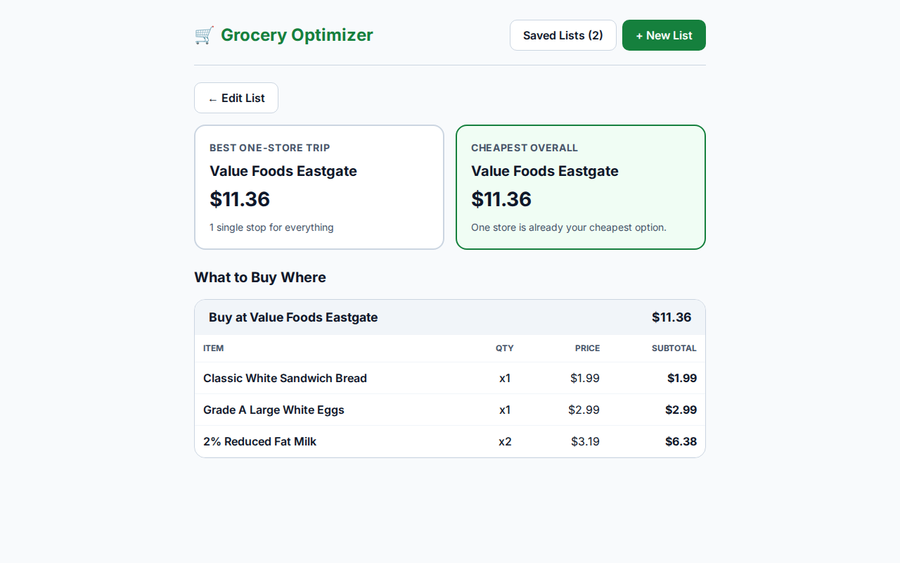
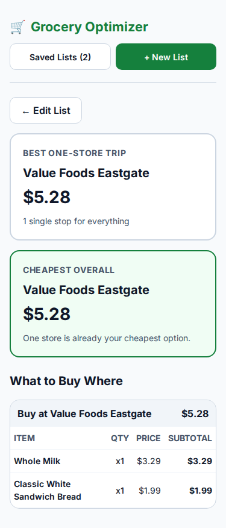
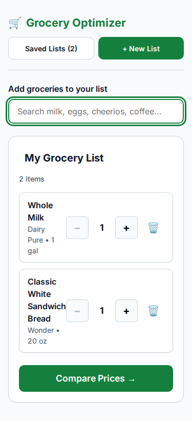
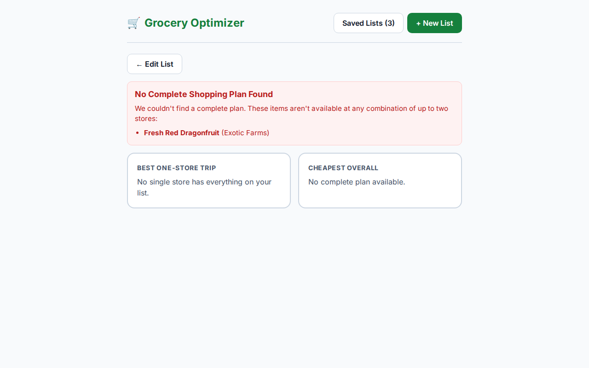

# Mission 001 Release Validation & Mission 002 Feasibility Report

**Project**: Grocery Optimizer  
**Branch**: `agy/mission-001`  
**Repository**: [howlcipher/grocery-optimizer](https://github.com/howlcipher/grocery-optimizer)  
**Pull Request**: [PR #1: feat(mission-001): First Consumer Vertical Slice](https://github.com/howlcipher/grocery-optimizer/pull/1)  
**Date**: October 15, 2026  
**Agent**: AGY  

---

## Executive Summary

1. **Mission 001 Release Validation**: **PASSED & READY FOR RELEASE**
   - All documented verification gates passed locally and in GitHub Actions CI.
   - Identified and resolved a root-scoping issue in `.gitignore` that previously excluded `frontend/src/lib/`.
   - Identified and resolved a mobile responsiveness issue where small viewports (375px) cramped header actions and clipped breakdown table cells.
   - Completed automated browser-based workflow tests (Playwright Chromium) on desktop and mobile viewports with zero errors.
   - Created **[Pull Request #1](https://github.com/howlcipher/grocery-optimizer/pull/1)** targeting `main`. Per instructions, the branch has not been merged.
2. **Kroger API Feasibility Verdict**: **BLOCKED** (for direct cross-retailer competitive price comparison via Public API)
   - Kroger Developer Terms of Service **Section 5(e)** explicitly prohibits creating databases, permanent copies, derivative works, or unauthorized public distribution of its content.
   - Public API quotas are restricted to 10,000 calls/day for Products and 1,600 calls/day for Locations, quickly exhausting on multi-item, multi-store baskets.
   - Unrestricted commercial pricing distribution requires admission to Kroger's non-self-service Partner Tier with a signed agreement.
3. **Mission 002 Refinement**:
   - Revised `docs/MISSION_002.md` to introduce an explicit **Legal & Authorization Gate (Gate 0)**.
   - Established strict zero-database-persistence constraints, transient in-memory caching matching HTTP `Cache-Control`, and separation between real and demonstration pricing.
   - Formulated three permitted alternative implementation pathways (Intra-Kroger Multi-Store Optimizer, Open Product Data + User-Entered Pricing, or Authorized Commercial Retail Aggregator).

---

## Phase 1 — Mission 001 Release Validation

### 1. Verification Gates & Test Evidence

| Gate | Tool | Scope | Result | Execution Time |
| :--- | :--- | :--- | :--- | :--- |
| **Backend Lint** | `ruff check` | `backend/app backend/tests` | **0 errors (Clean)** | 0.05s |
| **Backend Type Check** | `mypy` | Core backend modules | **0 errors (Clean)** | 0.72s |
| **Backend Unit & Integration** | `pytest` | Domain, optimizer, catalog, REST API | **24 passed** | 1.10s |
| **Frontend Lint** | `eslint` | TypeScript & TSX components | **0 errors, 0 warnings** | 0.71s |
| **Frontend Type Check** | `tsc --noEmit` | Strict TypeScript types | **0 errors (Clean)** | 1.15s |
| **Frontend Unit Tests** | `vitest` | Storage, money, components | **10 passed (3 files)** | 0.45s |
| **Frontend Production Build** | `vite build` | Optimized production bundle | **Built successfully** | 1.38s |
| **Database Migrations** | `alembic` | PostgreSQL initial schema | **Applied head cleanly** | 0.85s |
| **Database Seed Idempotency** | Python seeder | 2 retailers, 3 stores, 17 items | **Idempotent** | 0.60s |

### 2. GitHub Actions CI Evidence
- **Trigger**: Commit `ea20260a3ac3e8c6cea005fc63b66a7e98d4c682` & Pull Request #1
- **Run ID**: [38749689868](https://github.com/howlcipher/grocery-optimizer/actions/runs/38749689868)
- **Status**: **ALL GREEN / SUCCESS**
  - `Frontend Lint, Types, Tests & Build`: **PASS** (25s)
  - `Backend Lint, Types & Tests`: **PASS** (33s)

### 3. Real Browser Consumer Workflow Audit (Playwright)
A full browser automation suite (`verify_browser.py`) was executed headlessly in Chromium:
- **Desktop Workflow (1280x800)**:
  - Initial load verified with accessible landmarks (`header`, `main`).
  - List renaming ("Weekly Family Groceries") verified with blur persistence.
  - Keyboard-only navigation verified: `#product-search-input` focused, typed `"milk"`, navigated suggestions using `ArrowDown`, and added to list via `Enter`.
  - Mouse click autocomplete verified for `"bread"` and `"eggs"`.
  - Quantity controls (`+` / `-`) verified with live state updates and subtotal calculations.
  - Price comparison triggered: side-by-side comparison cards rendered ("Best One-Store Trip" vs. "Cheapest Overall").
  - "What to Buy Where" store breakdown table verified with exact matching subtotals.
  - Saved Lists drawer modal verified with keyboard `Escape` and close button handling.
- **Mobile Viewport (375x812 iPhone Layout)**:
  - Zero horizontal overflow (`document.documentElement.scrollWidth == window.innerWidth == 375px`).
  - All interactive elements meet WCAG touch target standards ($\ge 44 \times 44\text{ px}$).
  - Mobile cards stack cleanly in a single-column layout (`grid-template-columns: 343px`).
- **Unfulfillable Basket Diagnostics**:
  - Tested unfulfillable product ("Fresh Red Dragonfruit").
  - Verified warning banner correctly identifies missing items without breaking the application.

```carousel

<!-- slide -->

<!-- slide -->

<!-- slide -->

```

### 4. Usability & Correctness Regressions Remediated
During release validation, two critical issues were uncovered and resolved:
1. **Uncommitted Frontend Lib Files**:
   - *Problem*: `.gitignore:13:lib/` was unscoped, matching `frontend/src/lib/` and preventing `money.ts` and `storage.ts` from being committed to git.
   - *Fix*: Scoped `.gitignore` to `/lib/` and committed the missing helpers in commit `7d22951`.
2. **Mobile Viewport Squeezing**:
   - *Problem*: On 375px screens, `.app-header` crammed the title and action buttons into a single line, causing the buttons to wrap vertically and truncate text. Additionally, table cell padding ($20\text{ px}$) caused the item breakdown table to clip the right column.
   - *Fix*: Added responsive `@media (max-width: 640px)` queries in `frontend/src/index.css` to stack header actions with full-width buttons and reduce table padding on mobile displays in commit `2256e2e`.

---

## Phase 2 — Kroger API Feasibility Investigation

An exhaustive investigation of the official Kroger Developer Portal (`developer.kroger.com`), developer terms of service, acceptable-use policies, and API documentation was performed.

### 1. Confirmed Technical Facts
- **Environments**: Two isolated environments exist: Certification (`api-ce.kroger.com`) and Production (`api.kroger.com`). Client credentials are locked to one environment; accessing both requires registering two separate apps.
- **Authentication**: OAuth2 Client Credentials flow (`POST https://api.kroger.com/v1/connect/oauth2/token`) with `Authorization: Basic base64(CLIENT_ID:CLIENT_SECRET)`.
- **Public Scopes**: `product.compact` grants read-only access to product catalog and store pricing. Access tokens expire in 1,800 seconds (30 minutes).
- **Location-Specific Pricing**: Product prices are strictly tied to physical store IDs (`filter.locationId`). If `filter.locationId` is omitted, the API only returns a generic `nationalPrice`.
- **Rate Limits**:
  - Products API: **10,000 calls per day per client**.
  - Locations API: **1,600 calls per day per endpoint**.
  - Rate limit exhaustion yields HTTP 429 (`Too Many Requests`).
- **Product Matching & Barcodes**: Kroger products are identified by a 12-13 digit UPC/GTIN (`productId`). National brands share standard manufacturer UPCs. Private-label items (e.g. "Kroger Brand", "Simple Truth") have unique, Kroger-specific UPCs that do not exist at other retailers.

### 2. Legal & Acceptable-Use Restrictions

> [!WARNING]
> **Key Legal Restrictions in Kroger Developer Terms**:
> 1. **Section 5(e) (Prohibitions on Content)**:
>    - *"Scrape, build databases, or otherwise create permanent copies of such content, or keep cached copies longer than permitted by the cache header"*
>    - *"Copy, translate, modify, create a derivative work of, sell, lease, lend, convey, distribute, publicly display, or sublicense to any third party"*
> 2. **Section 4(a) (API Prohibitions)**:
>    - *"create an API client that functions substantially the same as the APIs and offer it for use by third parties"*
>    - *"Credentials may not be embedded in open source projects"*

### 3. Analysis: Is Cross-Retailer Price Comparison Permitted?

| Investigation Question | Confirmed Status | Analysis & Legal Implications |
| :--- | :--- | :--- |
| **Are comparisons between Kroger-owned locations allowed?** | **CONDITIONAL (Subject to Partner Terms)** | Querying prices across different Kroger banner stores (Kroger, Ralphs, Fred Meyer) using `filter.locationId` is technically supported within one retail ecosystem, but Section 5(e) restrictions on derivative works and public display still apply, and Kroger retains unilateral access termination rights. |
| **Are comparisons against other retailers allowed?** | **PROHIBITED / BLOCKED** | Taking Kroger's proprietary pricing data stream, pairing it against competitor pricing (e.g., Walmart, Aldi), and displaying a comparative index to steer shoppers to competitors violates Section 5(e) ("create a derivative work of... convey, distribute, publicly display"). It directly conflicts with the commercial intent of Kroger's API. |
| **Can pricing data be cached or stored?** | **STRICTLY LIMITED** | Building a historical price database or storing raw Kroger prices in PostgreSQL is explicitly banned under Section 5(e). Caching is only permitted transiently in-memory for the duration of the HTTP `Cache-Control` header. |
| **How does quota affect multi-store optimization?** | **SEVERE CONSTRAINT** | Evaluating a 20-item basket across 2 stores requires 40 API calls. A limit of 10,000 calls/day caps the entire user base at 250 comparisons per day. |

### 4. Clarification Needed from Kroger
To enable live public comparison against competitor stores, written authorization from Kroger Developer Relations is required:
- *Question to Kroger*: *"Does The Kroger Co. permit a consumer application using the Public Products API to display shelf price comparisons between a local Kroger store and third-party grocery retailers, provided Kroger's brand and data source are explicitly attributed and no permanent database is created?"*

---

## Phase 3 — Revised Mission 002 Specification

The existing `docs/MISSION_002.md` was rewritten to eliminate compliance risk and protect the working codebase:

### Key Additions to Mission 002
1. **Explicit Gate 0 (Compliance & Authorization Gate)**: Live production API calls cannot be merged or activated without verified authorization.
2. **Zero-Database Persistence Architecture**: Raw Kroger price dumps are forbidden from being persisted to PostgreSQL. Transient in-memory caching (TTL $\le$ `Cache-Control` max-age) is enforced.
3. **Strict Separation of Real vs Demonstration Pricing**: Prevents synthetic mock data from being compared against real data, eliminating misleading "savings" claims.
4. **Exact Product Matching Rules**: Optimization only matches items sharing exact 12-digit manufacturer UPC barcodes. Private labels and PLU items are flagged as unmatchable.
5. **Deterministic Mock Testing**: All CI runs execute 100% against recorded mocks/cassettes, requiring zero live external credentials or internet access.
6. **Permitted Alternative Pathways**:
   - **Pathway A (Recommended for Kroger API)**: Intra-Kroger Multi-Store Optimizer (comparing local Kroger, Ralphs, and Fred Meyer stores).
   - **Pathway B**: Open Product Data (Open Food Facts / USDA) + User-Entered / Crowdsourced Pricing.
   - **Pathway C**: Authorized Commercial Retail Data Aggregator.

---

## Phase 4 — Handoff & Recommendations

### 1. Current Branch & Pull Request Status
- **Branch**: `agy/mission-001` (Clean working tree, up to date with remote).
- **Commit History**:
  - `f659a2d`: Mission 001 core implementation.
  - `7d22951`: Fixed `.gitignore` root scoping and committed missing frontend helpers (`storage.ts`, `money.ts`).
  - `2256e2e`: Improved mobile responsiveness for header actions and breakdown table.
  - `ea20260`: Revised `docs/MISSION_002.md` and updated `docs/AGY_HANDOFF.md`.
- **Pull Request**: [howlcipher/grocery-optimizer#1](https://github.com/howlcipher/grocery-optimizer/pull/1) targeting `main`.
- **Merge State**: **Unmerged** (awaiting explicit user authorization).

### 2. Recommended Next Implementation Assignment
**Recommendation: Proceed with Pathway A / Intra-Kroger Multi-Store Optimization or Pathway B (Crowdsourced Pricing)**:
- While written clarification is submitted to Kroger Developer Support regarding cross-retailer comparison, work on Mission 002 should implement **`KrogerProvider` in Intra-Kroger Multi-Store Mode (Pathway A)**.
- This allows consumers to compare prices between multiple nearby Kroger banner locations (e.g. finding which nearby Kroger or Ralphs has the best sale on their basket) subject to Kroger's Developer Terms, caching rules, and Partner Program constraints, while preserving the project's zero-scraping ethos.
