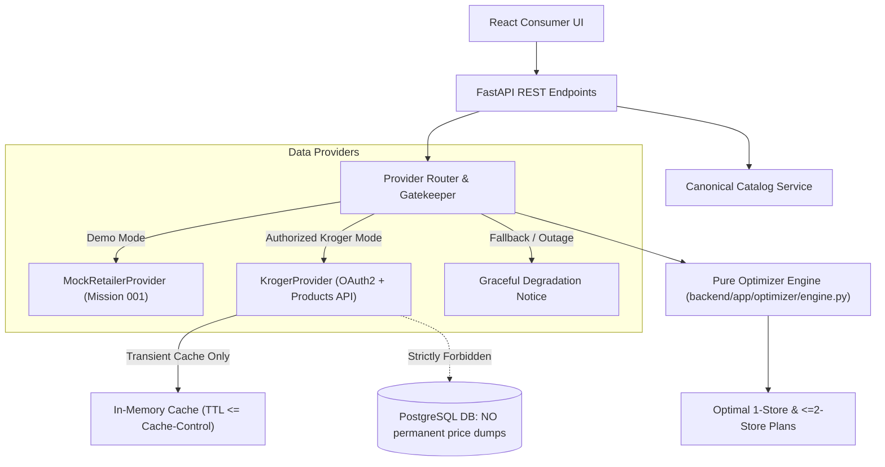

# Grocery Optimizer
## Mission 002 — Retail Pricing Integration & Feasibility Architecture

**Predecessor:** `docs/MISSION_001.md` (Accepted & Released)  
**Campaign ID:** `2026-09-27-continuous-improvement`  
**Feasibility Assessment Status:** **BLOCKED PENDING AUTHORIZATION** (Audit completed Oct 15, 2026)  
**Specification Status:** REVISED WITH COMPLIANCE GATES  

---

## 1. Executive Summary & Feasibility Verdict

Following a thorough investigation of the official Kroger Developer Portal (`developer.kroger.com`), developer terms of service, acceptable-use restrictions, and API specifications:

### Feasibility Verdict: **BLOCKED** (for direct cross-retailer competitive price comparison via Public API)

### Basis for Verdict:
1. **Legal & Acceptable-Use Barriers (Section 5(e) & Section 4)**:
   - **Prohibition on Database Creation & Caching**: Section 5(e) explicitly prohibits developers to *"scrape, build databases, or otherwise create permanent copies of such content, or keep cached copies longer than permitted by the cache header."* Storing price histories or catalogs in the application database violates this clause.
   - **Prohibition on Derivative Works & Public Display**: Section 5(e) prohibits developers to *"create a derivative work of, sell, lease, lend, convey, distribute, publicly display, or sublicense to any third party."* Generating comparative indices or displaying price comparisons that steer consumers toward competitors risks being classified as unauthorized derivative works and commercial diversion.
   - **No Exclusivity & Competitive Rights**: Kroger explicitly reserves all rights to monitor API clients and terminate access immediately without notice if an application acts against Kroger's commercial interests.
2. **Quota & Rate Limit Constraints**:
   - The Public API imposes a hard limit of **10,000 calls per day** on the Products API and **1,600 calls per day** on the Locations API.
   - Multi-item baskets (e.g., 20 items evaluated across 2 stores = 40 requests) would exhaust daily quota in just 250 user comparisons.
   - Quota exhaustion results in HTTP 429 (`Too Many Requests`), breaking consumer workflows without commercial partner access.
3. **Commercial Partner Tier Requirements**:
   - Unrestricted catalog access, higher quotas, and production commercial distribution require admission into the **Kroger Partner Program**, which is non-self-service and requires a formal signed contract and security review with Kroger Digital.

---

## 2. Permitted vs. Impermissible Use Matrix

| Use Case | Status | Notes / Conditions |
| :--- | :--- | :--- |
| **Intra-Kroger Store Comparison** (e.g. Kroger Store A vs Kroger Store B or Ralphs vs Fred Meyer) | **PERMITTED (Conditional)** | Allowed under Kroger developer terms if prices are fetched in real-time, cached only within HTTP cache headers, and attributed accurately. |
| **Cross-Retailer Comparison (Kroger vs. Walmart / Aldi)** via Kroger Public API | **PROHIBITED without Partner Agreement** | Violates Section 5(e) derivative work, database building, and redistribution clauses without written commercial authorization. |
| **Scraping Kroger Website or Circumventing API** | **STRICTLY PROHIBITED** | Violates Kroger terms of use and computer fraud provisions. Scrapers will never be used. |
| **Simulated Comparison using Synthetic Mock Data** | **PERMITTED** | Fully permitted for design, testing, and algorithmic demonstration, provided it is prominently labeled as synthetic/demonstration data. |
| **User-Entered / Crowdsourced Pricing** | **PERMITTED** | Shoppers submit receipt or shelf prices directly; 100% compliant with all retailer terms. |
| **Licensed Aggregator API (e.g. Authorized Retail Intelligence)** | **PERMITTED** | If pricing data is licensed through an authorized provider contractually permitted to supply competitive data. |

---

## 3. Revised Scope of Mission 002

To preserve project momentum without violating compliance or fabricating access, Mission 002 is structured around **three verifiable gates**:

### Gate 0: Compliance & Authorization Gate (Prerequisite)
Before any live calls to `api.kroger.com` are enabled in production:
1. Formal developer registration on `developer.kroger.com` must be completed.
2. Written clarification or a Partner Agreement must be sought from Kroger Developer Support confirming whether consumer price comparison using the Products API is permissible.
3. If permitted: Implement `KrogerProvider` in strict compliance with cache headers.
4. If denied or unconfirmed: Direct live traffic is suspended; application operates in **Authorized Alternative Mode** (see Section 6).

### In-Scope Implementation (Dual-Mode Architecture)
1. **Preservation of Mission 001 Baseline**:
   - The pure deterministic optimizer (`backend/app/optimizer/engine.py`), catalog search, and mobile-first consumer UI remain 100% functional.
2. **Retailer Provider Abstraction & Kroger Client (`backend/app/providers/kroger.py`)**:
   - Implements `RetailerProvider` protocol using OAuth2 Client Credentials grant (`https://api.kroger.com/v1/connect/oauth2/token`).
   - Token lifecycle management (caching access tokens for 1800s expiration).
   - Location lookup via `GET /v1/locations` with ZIP code radius filtering.
   - Product lookup via `GET /v1/products` using `filter.productId` (UPC) and `filter.locationId`.
   - Strict transient in-memory caching honoring upstream `Cache-Control` headers (no permanent database persistence of Kroger price tables).
3. **Resilience, Circuit Breaking & Rate Limiting**:
   - Automatic exponential backoff on HTTP 429 (`Too Many Requests`) and 5xx server errors.
   - Circuit-breaker that temporarily disables live lookups and falls back gracefully when quota is depleted or Kroger API is degraded.
4. **Data Integrity & Labeling**:
   - Clear UI badges distinguishing `Live Store Data` vs `Demonstration Data`.
   - Prevention of misleading savings calculations: The system will **never** compare a live price from one store against synthetic/mock data from another store to claim "savings".
5. **Exact Product Matching Guardrails**:
   - Only exact 12-digit UPC / 13-digit EAN manufacturer barcodes are compared.
   - Distinct package sizes, private-label store brands, and unverified SKUs are explicitly flagged as unmatchable.

---

## 4. Architectural Guardrails & Constraints

1. **Zero Database Price Storage**: Complying with Section 5(e), raw Kroger pricing responses are never written to the Postgres database. The database stores only the consumer's personal grocery lists and canonical product catalog definitions.
2. **Transient In-Memory Caching Only**: Real-time prices may be cached in-memory only for the duration specified by Kroger's HTTP `Cache-Control` max-age header (or 15 minutes default), and immediately discarded.
3. **Deterministic Automated Testing**: All CI runs and automated tests must execute against recorded responses (VCR/cassettes or static mocks). Zero external network requests during CI.
4. **Credential Security**: `KROGER_CLIENT_ID` and `KROGER_CLIENT_SECRET` must only be loaded via environment variables; never committed to git or exposed in client bundles.

---

## 5. Alternative Implementation Pathways

If Kroger denies permission for cross-retailer competitive comparison, Mission 002 will execute one of the following authorized alternatives:

### Pathway A: Intra-Kroger Multi-Store Optimizer (Recommended for Kroger API)
- **Concept**: Compare pricing and inventory across different Kroger-owned banner locations within a metro area (e.g., Kroger vs. Ralphs vs. Fred Meyer vs. Dillons).
- **Compliance**: 100% compliant with Kroger developer terms (benefits Kroger ecosystem, zero competitor disparagement).
- **Consumer Value**: Shoppers discover which nearby Kroger banner offers the best promotional discounts for their weekly list.

### Pathway B: Open Product Data & User-Contributed Pricing
- **Concept**: Integrate Open Food Facts / USDA FoodData Central for canonical UPC catalog and allow shoppers to enter or scan prices locally.
- **Compliance**: 100% independent of restrictive retailer APIs.

### Pathway C: Authorized Commercial Retail API
- **Concept**: Connect to an authorized data provider contractually licensed to distribute multi-retailer shelf prices.

---

## 6. Verification Gates & Acceptance Checklist

To complete Mission 002, the implementation must pass all of the following verification gates:

- [ ] **Gate 0 — Legal & Permitted Use Gate**: Written developer terms review and verification of intended comparison scope.
- [ ] **Gate 1 — OAuth2 & Authentication**: Client credentials grant verified, token caching and automatic refresh before expiration verified with deterministic tests.
- [ ] **Gate 2 — Zero-Persistence Compliance**: Code audit confirming zero storage of raw Kroger price records in relational database.
- [ ] **Gate 3 — Exact Product Matching**: Barcode verification test ensuring only identical UPC/GTIN items are matched across store offers.
- [ ] **Gate 4 — Rate Limit & Resilience**: Test suite verifying graceful handling of HTTP 429 quota exhaustion and network timeouts without UI crashes.
- [ ] **Gate 5 — Non-Misleading Pricing**: Verification that real and demonstration prices are strictly separated and never mixed in savings math.
- [ ] **Gate 6 — Baseline Preservation**: All Mission 001 tests (24 backend, 10 frontend, browser workflows) continue to pass with zero regressions.
- [ ] **Gate 7 — Independent Technical Review**: Formal review by an independent audit subagent before any merge to `main`.
